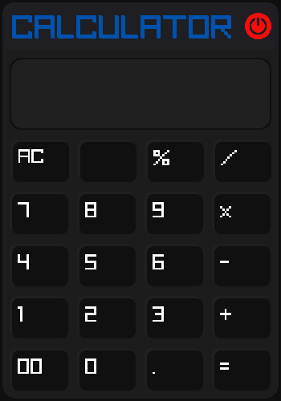
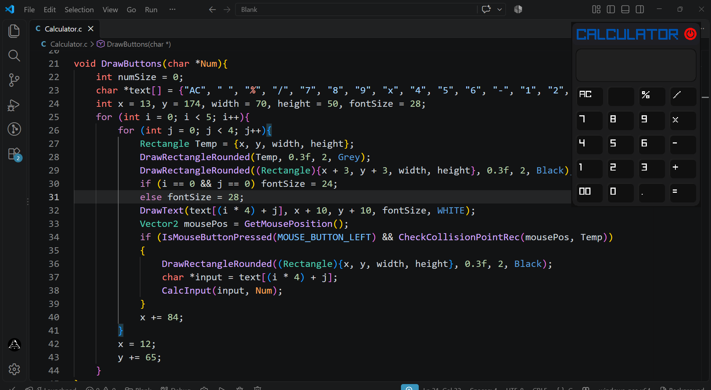

# Raylib Calculator  

A simple calculator project build using C and Raylib to practice graphics programming, UI Design, and user input handling.    
The project is currently a work in progress, with calculation logic still being developed.  
Created to showcase my programming skills in C language.  

## Preview

  

  

