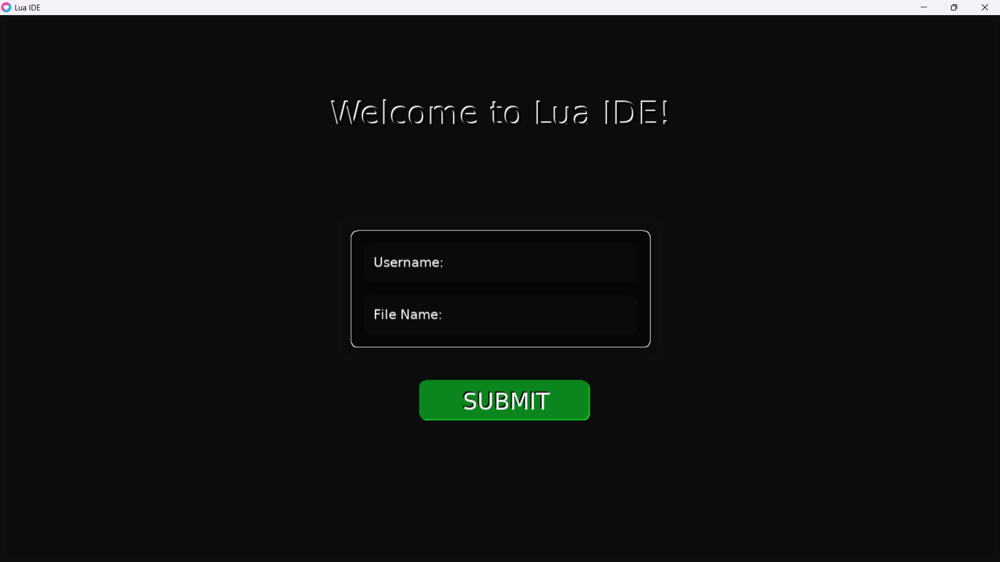
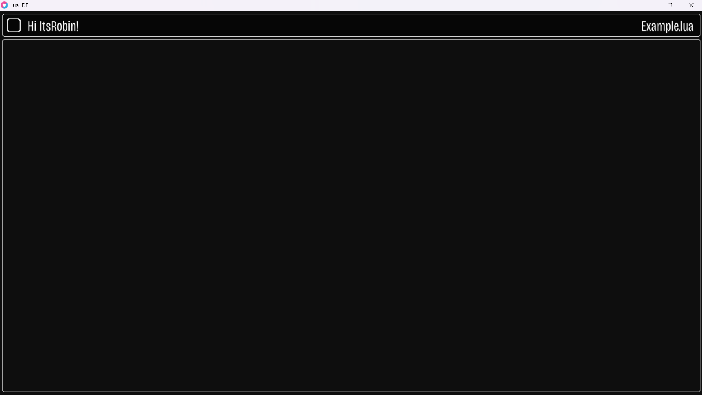
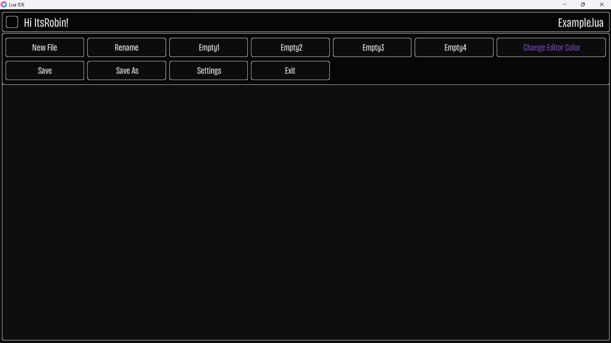
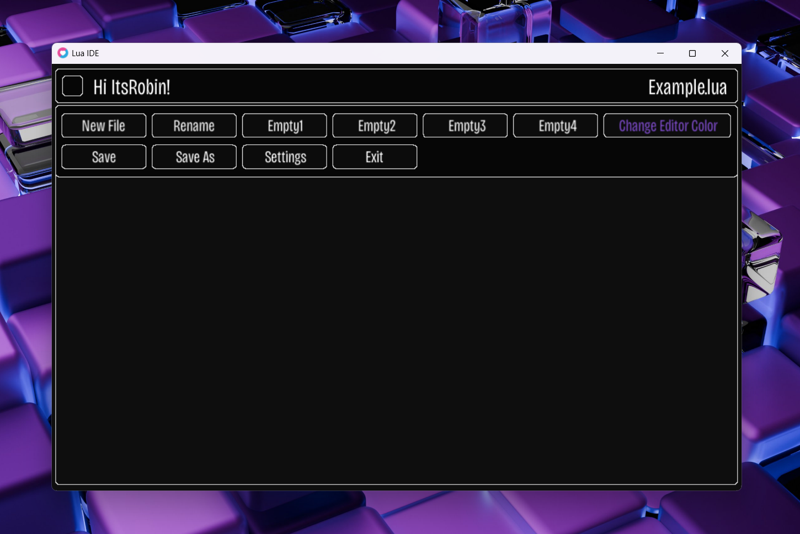

## Lua Love2D Text Editor  

Building a small text editor using Lua and the LÖVE2D framework.  

### About   

This is a personal learning project focused on exploring Lua and the LÖVE2D framework by building a text editor from scratch. The goal is to develop a basic editor and gradually improve its features, interface, and usability.

### Current Build Includes  
The current build of the editor includes:  
- Login Screen  
- Editor Layout  
- Main Menu  
  
### Screenshots

Here are some screenshots of the initial prototype.  

1. Login Screen   
   

2. Editor Layout   
  

3. Main Menu  
  

4. Extra

### Requirement
To run this project you need:
- Love2D Version 11.4
- Lua Version 5.4 or above.

### How To Run
- Install LÖVE2D on your system.
- Clone or download this repository.
- Run the project using either of the following methods:  
  Drag the project folder onto `love.exe`
  In terminal navigate to the project directory and run: `love .` and pass the project folder path as an argument to the `love` executable.

### Future Improvements
- Implement text editing functionality 
- Add file opening and saving.
- Editor Interface Improvements
- Make all buttons functional.

### Project Update:- 
The development of this project has moved to its own repository and will continue there. For more information, check out my Lua Love2D Text Editor repository.
